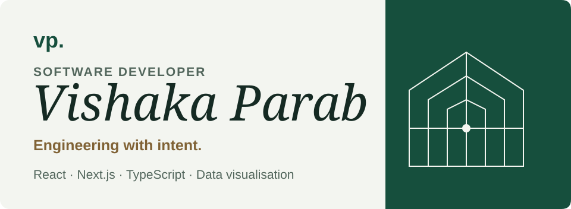
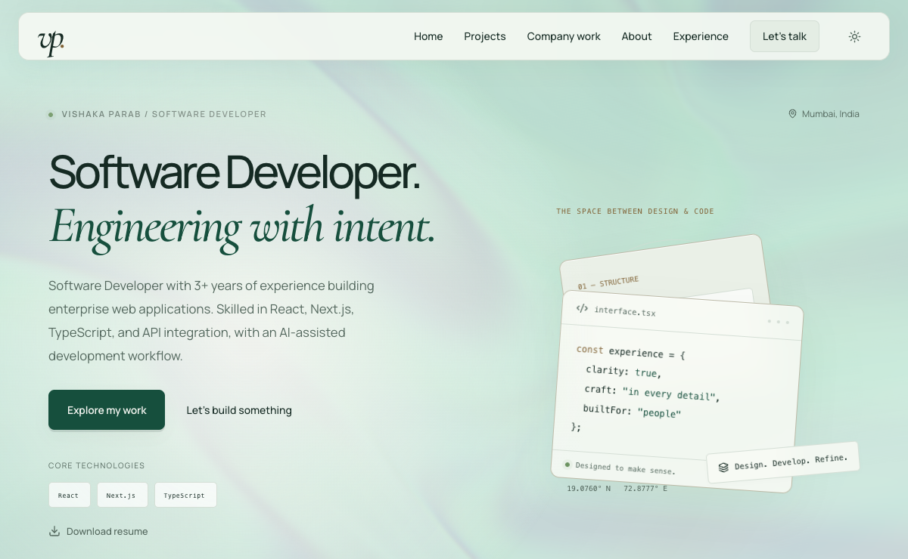
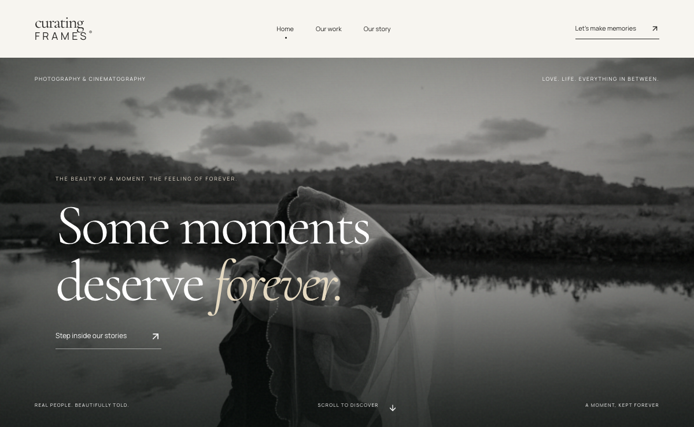
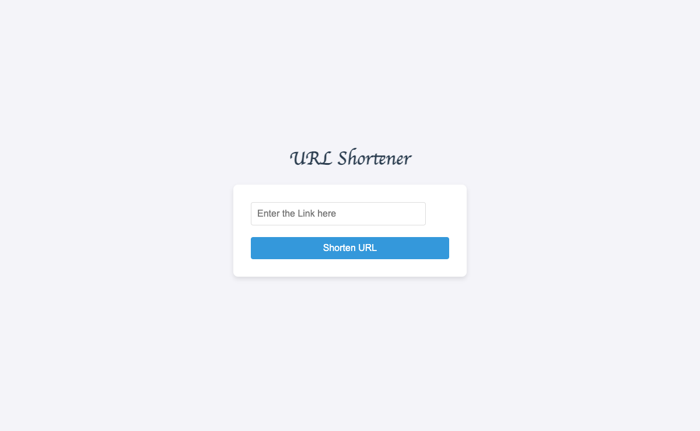
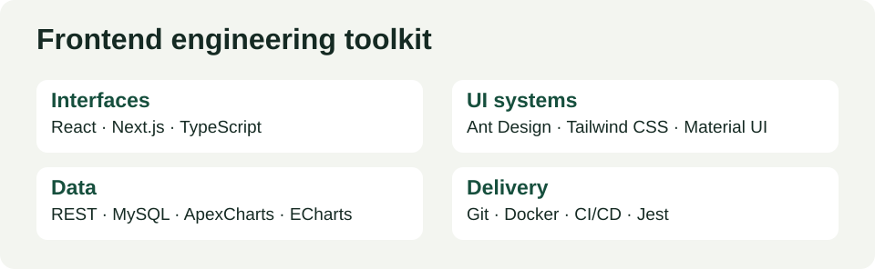
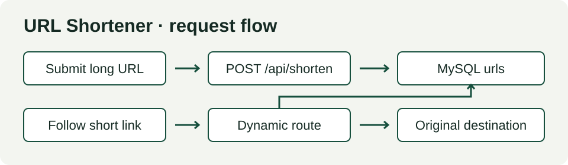
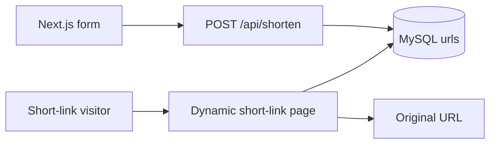
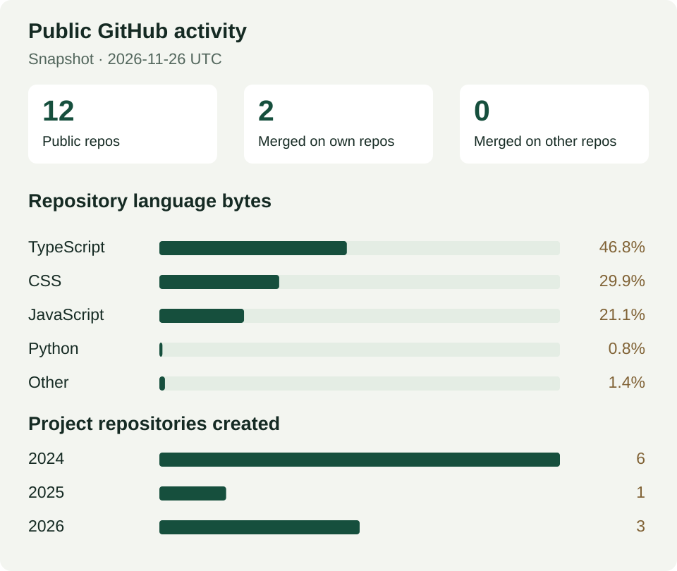
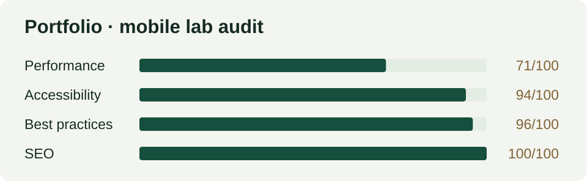

# Vishaka Parab

<picture>
  <source media="(prefers-color-scheme: dark)" srcset="assets/banners/hero-dark.svg">
  
</picture>

I’m a frontend-focused software developer. I build enterprise web applications, reusable component systems, and data-heavy interfaces with React, Next.js, and TypeScript.

[Portfolio](https://vishaka-parab-portfolio.vercel.app/) · [LinkedIn](https://www.linkedin.com/in/vishakaparab/) · [Repositories](https://github.com/vishaka1203?tab=repositories) · [Get in touch](https://vishaka-parab-portfolio.vercel.app/#contact)

## Engineering with intent

I’ve worked in frontend engineering since August 2023, from responsive React components and REST integrations to Next.js dashboards for cloud security, governance, and reporting. I enjoy taking a dense workflow and making it easier to understand, use, and maintain.

Alongside enterprise work, I build websites as a freelancer. I’m interested in collaborating on web projects where design and engineering shape the product together. I’m currently going deeper on Next.js architecture, backend workflows, database design, and performance.

## Engineering at a glance

- **Frontend engineering since August 2023** · Enterprise web applications, reusable UI, REST integration, and data visualisation.
- **Recent public work** · A Next.js engineering portfolio, a photography site, and independent React DOM testing.
- **Current focus** · Next.js architecture, database-backed workflows, and web performance.

## Professional journey

**Softcell Technologies · Software Developer, Frontend**

Nov 2025 – present. I build modular Next.js dashboards for Cloud Protect, create reusable Ant Design interfaces and ApexCharts/ECharts visualisations, and integrate APIs. I also support Docker deployments, CI/CD maintenance, UAT, and production testing.

**Al Madina Logistics / Bayanat Technology · Frontend Developer**

Jan 2025 – Oct 2025. I worked on HR and logistics budget-management interfaces, including payroll, attendance, leave tracking, and expenses, using reusable React and TypeScript components.

**Global Minds Limited · Frontend React.js Developer**

Aug 2023 – Dec 2024. I built responsive frontend components, integrated REST APIs, resolved UI issues, and supported Agile deployments.

## Selected work

### Vishaka Parab · Engineering portfolio

I built a content-driven portfolio that brings together career history, engineering project notes, and public repository metadata. It uses Next.js, TypeScript, MDX, and a shared light and dark design system. The site keeps project content separate from the components that present it.

[Live portfolio](https://vishaka-parab-portfolio.vercel.app/) · [Source](https://github.com/vishaka1203/vishaka-parab-portfolio)

### Curating Frames · Photography portfolio

I built a photography site with filterable collections, individual galleries, and an enquiry flow. Next.js, TypeScript, Tailwind CSS, and GSAP support the interface. Structured collection data keeps new galleries independent of component changes, while the enquiry endpoint validates submissions before attempting delivery.

[Live site](https://curating-frames.vercel.app/) · [Source](https://github.com/vishaka1203/curating-frames) · [Case study](https://vishaka-parab-portfolio.vercel.app/projects/curating-frames)

### Hospital and Research Center · Appointment workflow

I built a React hospital website with a separate Node.js appointment backend. My public changes cover the appointment form and the backend email flow. The split makes the interface and server responsibilities easy to trace across the two repositories.

[Frontend](https://github.com/vishaka1203/Hospital-and-Research-Center) · [Backend](https://github.com/vishaka1203/Hospital-and-Research-Center-Backend) · [Case study](https://vishaka-parab-portfolio.vercel.app/projects/hospital-research)

### URL Shortener · Full-stack utility

I built a Next.js utility that maps long links to short codes in MySQL. The API reuses the stored code for a known URL, and the server resolves the short code when a visitor follows the link.

[Live interface](https://url-shortener-vishaka.vercel.app/) · [Source](https://github.com/vishaka1203/URL-Shortener) · [Case study](https://vishaka-parab-portfolio.vercel.app/projects/url-shortener)

Earlier work

- **Wushu Goa** — sports organisation web project built with Next.js, TypeScript, and Once UI. [Source](https://github.com/vishaka1203/Wushu-Goa) · [Case study](https://vishaka-parab-portfolio.vercel.app/projects/wushu-goa)
- **Earlier React portfolio** — responsive personal site built with React. [Live site](https://vishakaparab-portfolio.netlify.app/) · [Source](https://github.com/vishaka1203/Portfolio-Website-using-React.js) · [Case study](https://vishaka-parab-portfolio.vercel.app/projects/react-portfolio)
- **Fursaahr Job Portal** — public repository for an international domestic-worker recruitment project. [Repository](https://github.com/vishaka1203/fursaahr-job-portal)

## The tools behind the thinking

<picture>
  <source media="(prefers-color-scheme: dark)" srcset="assets/charts/toolkit-dark.svg">
  
</picture>

- **Languages and interfaces** — JavaScript, TypeScript, HTML, CSS, React, and Next.js.
- **Components and state** — Ant Design, Material UI, Tailwind CSS, shadcn/ui, React Query, Jotai, and Context API.
- **Backend and data** — Node.js, Express, REST APIs, MySQL, MongoDB, ApexCharts, and ECharts.
- **Delivery and quality** — Git, Docker, CI/CD, Vercel, Jest, React Testing Library, SonarQube, and Postman.
- **Design and development workflow** — Figma for design collaboration. Cursor, Codex, and Claude for prototyping, debugging, and test preparation.

Additional tools from earlier projects and learning

React Router, Redux, React Hook Form, Bootstrap, Chakra UI, Vite, npm, C, C++, PHP, Python, Oracle, Canva, Jira, and Trello.

## Complexity, made clear

The URL Shortener separates link creation from redirect resolution. The creation API looks up a submitted URL and inserts a short code only when it needs one. The dynamic page looks up that code and redirects the visitor.

<picture>
  <source media="(prefers-color-scheme: dark)" srcset="assets/architecture/url-shortener-dark.svg">
  
</picture>

Mermaid diagram

[Source and engineering case studies](docs/CASE-STUDIES.md)

## Open-source journey

| Project | Contribution | Status and evidence |
| --- | --- | --- |
| React · CSS serialization | Reproduced numeric `hyphenateLimitLines` gaining an invalid pixel suffix. Implemented and tested a unitless fix on my fork and reported Safari 18.2 findings on the upstream PR. | Patch published on fork. Safari findings shared upstream. [Fork commit](https://github.com/vishaka1203/react/commit/66a4856ee5) · [Upstream verification comment](https://github.com/react/react/pull/38352#issuecomment-7172209660) |

The linked upstream PR was opened by another contributor.

## GitHub analytics

<picture>
  <source media="(prefers-color-scheme: dark)" srcset="assets/charts/github-dark.svg">
  
</picture>

[Current data, counting rules, and refresh instructions](docs/METRICS-METHODOLOGY.md). Language bytes reflect what GitHub detects in the included repositories. The PR counts cover public authored PRs. The React verification comment appears in the open-source section.

## Performance and engineering quality

<picture>
  <source media="(prefers-color-scheme: dark)" srcset="assets/charts/performance-dark.svg">
  
</picture>

A Lighthouse mobile lab run on the deployed portfolio measured **1.3 s LCP**, **2,090 ms total blocking time**, and **0 CLS**. Total blocking time was the main performance constraint in this run. [Audit conditions and reproduction steps](docs/METRICS-METHODOLOGY.md#portfolio-lighthouse-audit)

## Education and continuous learning

**B.E. in Computer Science** · Agnel Institute of Technology and Design, Goa · 2019–2023. My portfolio lists Oracle credentials in OCI Foundations, Cloud Data Management Foundations, and APEX Cloud Development. [Portfolio and résumé](https://vishaka-parab-portfolio.vercel.app/)

## Let’s build something meaningful

I’m open to frontend engineering opportunities, design-led freelance projects, and technical collaborations. Ask me about React, Next.js, or building responsive interfaces for complex workflows.

[Portfolio and contact](https://vishaka-parab-portfolio.vercel.app/#contact) · [LinkedIn](https://www.linkedin.com/in/vishakaparab/) · [GitHub](https://github.com/vishaka1203) · [Instagram](https://instagram.com/aldebaran_nova)

**vp.** · Thoughtfully designed. Carefully built.
